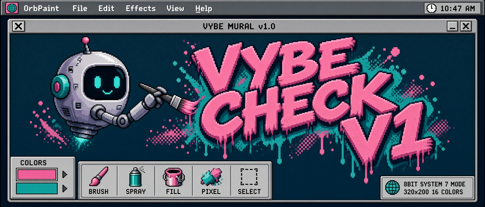

# Vybe-Check

**Public source release candidate.** Start with the [QC guide](QC_GUIDE.md). Final installed, native-store, and cross-platform verification remains pending.

A local workshop for refining image prompts, with an optional video continuation. Version `0.1.0rc1` is a release candidate. Source authoring is not proof of installation or platform support.

Start with an outcome, agree the visual direction, refine a version, and export the agreed prompt. Image-only work is complete on its own. The board shows the same saved state as the command line. It doesn't provide a conversational model or generate paid images or videos.

Use CPython 3.11 through 3.14. Follow the [Quickstart](docs/quickstart.md) for the invented ceramic workshop and kite examples. See [Privacy](docs/privacy.md) before adding reference media or optional advice, and [Lifecycle](docs/lifecycle.md) before updating or removing a registration.

The core saves local sessions and exports without a remote runtime service. Installing the package and dependencies is explicit package-manager work and can use the network. Optional local studies require your own compatible ComfyUI installation and checkpoint. Optional decision advice requires explicit credentials, outbound review, current bounded billing, and approval.

MIT licensed. See [LICENSE](LICENSE) and [Third-party notices](THIRD_PARTY_NOTICES.md). Real installed, native-store, and cross-platform verification remains pending for this candidate.
